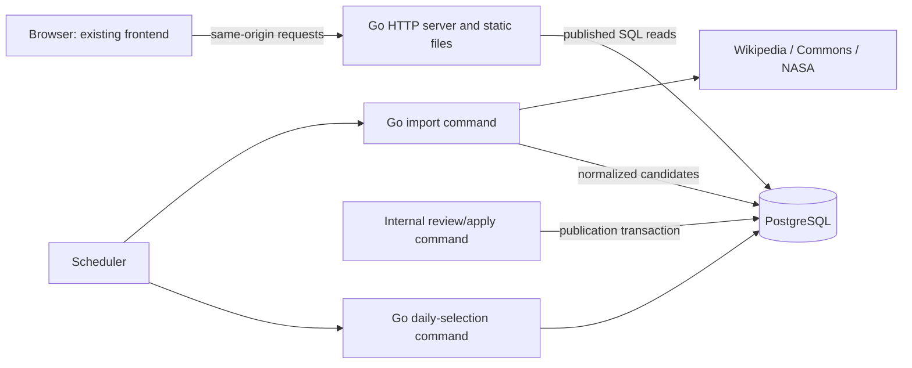

# Unseen — Backend Learning and Implementation Plan

Design baseline: 2026-10-22. Status: **A complete; implementation has not started.**

## 1. Purpose and teaching agreement

The primary purpose is to learn real-world backend engineering by building and operating Earth + Universe. Go, HTTP/API design, PostgreSQL, Docker, Kubernetes, and AWS are learned through the application's requirements. Success means the learner can explain, implement, change, test, and troubleshoot the backend independently.

The learner writes the core implementation and runs commands. The teacher explains each step, demonstrates a small example when needed, reviews changes, and helps interpret failures. Silently completing several milestones for the learner would defeat this plan.

Each lesson follows **outcome → necessary concepts → small example → learner task → review/verification → independent change → short learning note**. Introduce Go, SQL, HTTP, networking, and Git when needed. Begin B01 with a short practical check; finishing Docker does not establish the other prerequisites.

One milestone can contain several lessons. Work on one manageable task at a time and advance on demonstrated understanding, not elapsed days. Review correctness, clarity, failure handling, and the learner's explanation. Gradually reduce guidance and include realistic change requests and debugging exercises.

## 2. Reviewed inputs and changes

The project is the inner `unseen/` directory, with remote `https://github.com/dawitdargie/unseen.git`. All project implementation/documentation belongs there. The sibling `unseendesign/` is the frontend reference.

Reviewed: [PRD](PRD.md), [user flow](user_flow.md), Excalidraw flow, [architecture](system_architecture.md), [database](database_design.md), [API](api_design.md), [sources](data-sources.md), README, and the frontend HTML/CSS/JavaScript.

| Finding | Decision |
|---|---|
| Architecture specified Next.js/TypeScript; actual frontend is editable static HTML/CSS/JavaScript | Preserve that frontend and avoid a framework migration. |
| Eight hardcoded discoveries, hash routes, local filters, and a detail dialog | Keep the visual design; replace data/navigation with API calls and documented page routes. |
| Refresh rules preserve published content, but no proposed-update storage existed | Add reviewable import candidates and transactional publication. |
| Source policy mentions revisions/adaptations, but schema/API omitted them | Persist and expose relevant text provenance. |
| Import targets could be open-ended searches | Schedule curated stable IDs; use search manually to select candidates. |
| Taxonomy/daily fallback lacked final rules | Set six initial categories and explicit daily behavior. |
| Source feasibility remains open | Require the C04 spike before automatic ingestion; earlier samples do not prove the complete pipeline. |

Linked documents own detailed product/data/API rules; this file owns learning order and evidence. Change both when a decision changes. The drawing is a high-level flow; Markdown specifies detailed behavior.

## 3. Version-one scope

Ship Home with daily/new discoveries and search; Earth/Universe listings; domain/category filters and pagination; stable detail URLs with facts and separate text/image attribution; and category-based related discoveries. Serve public discovery data from PostgreSQL. Fetch providers outside visitor requests.

Automatic fetching means scheduled ingestion into reviewable candidates. Publication is an explicit internal editorial action. Daily selection automatically rotates already published content.

| Domain | Initial category slugs |
|---|---|
| Earth | `landscapes`, `caves`, `ecosystems` |
| Universe | `planets-moons`, `nebulae`, `galaxies` |

One category determines a discovery's domain. Socotra is `ecosystems`; a decorative label such as “botanical oddity” is not another taxonomy. Start database work with two manually reviewed records, one per domain. C04 must establish at least one publishable sample per initial category. Use additional clearly synthetic test records to exercise multiple pages.

Defer accounts/bookmarks, public mutation endpoints, admin UI, automatic editorial approval, geographic maps, microservices, queues, Redis, Elasticsearch, image uploads/hosting, advanced recommendations, and multi-region operation. Explore Earth/Universe means browsing in V1. If accounts remain unnecessary, authentication/authorization becomes a later separate backend exercise; public reads do not teach that skill.

## 4. Architecture and tool choices



The API, importer, review commands, and daily selection share one codebase, binary, and image. They are not separate network services. The scheduler starts commands; API replicas do not each run their own scheduler. Candidates are a table in the same database.

| Area | Choice and purpose |
|---|---|
| HTTP | Go `net/http`, `ServeMux`, `encoding/json`, `log/slog`; learn HTTP behavior directly. Modern ServeMux supports method/path patterns. [Reference](https://go.dev/blog/routing-enhancements). |
| SQL access | `database/sql` with [pgx v5 stdlib](https://github.com/jackc/pgx); parameterized SQL and explicit connection pooling. |
| Migrations | Numbered SQL migrations through a pinned [goose](https://github.com/pressly/goose) CLI. |
| Search | PostgreSQL English full-text search, weighted ranking, `websearch_to_tsquery`, and a GIN index. [Reference](https://www.postgresql.org/docs/current/textsearch-controls.html). |
| Frontend | Existing HTML/CSS/browser JavaScript adapted into `web/`; relative `/api/v1` requests. |
| Docker | PostgreSQL first; full application in Compose after the first API slice. |
| Kubernetes | One local kind cluster, plain manifests first. Verify workstation prerequisites before installation. |
| AWS | ECR image + EKS app/Jobs + private RDS PostgreSQL + HTTPS entry + managed secrets + CloudWatch logs. |
| Delivery | GitHub Actions checks/builds; a small Terraform stack introduced only during AWS lessons. |
| Python | Separate focused practice unless a concrete application need appears. |

Pin supported tool/image versions when introduced. Record them in the repo; recheck regional RDS compatibility before provisioning. Do not assume `latest` provides reproducible builds.

Go serves static files and the frontend shell for `/`, `/explore`, and `/discoveries/{slug}`. The browser renders the matching view. API routes and missing asset paths must never fall through to HTML. Use root-relative assets so detail-page refreshes work. An unavailable discovery initially gets a frontend not-found view after its API returns 404; the static page shell itself can return 200. Server-rendered detail status/SEO metadata is deferred.

Create directories only as needed:

```text
unseen/
  cmd/unseen/          # serve, import, review/apply, publish/unpublish, daily
  internal/config/     # validated runtime configuration
  internal/httpapi/    # routes, validation, JSON, error translation
  internal/discovery/  # publication/daily rules as needed
  internal/store/      # SQL and transactions
  internal/ingest/     # provider clients and normalization
  migrations/          # versioned SQL
  web/                 # selected existing frontend assets
  testdata/            # documented fixtures
  deploy/              # Compose, Kubernetes, then Terraform
  docs/                # contracts, learning notes, runbooks
  .github/workflows/   # checks, then delivery
```

Keep reads simple: handler → store → response. Add service functions for actual business rules and interfaces at genuine dependency boundaries. Avoid a generic repository framework or unused abstractions. Keep relationships/status/source identity relational; flexible optional facts can be JSONB.

## 5. Backend rules

### API and storage

Follow [api_design.md](api_design.md) and [database_design.md](database_design.md). All public queries filter published content. Published slugs stay stable; reserve `daily`. Use explicit query validation, SQL parameters, bounded inputs, stable sorting, and consistent errors. Offset pagination fits this catalog; separate page requests are not a frozen snapshot during publication.

Source identity prevents repeat imports of one record, not several NASA images of the same object. Editorial curation handles subject duplicates. Normalize source markup to plain text and validate URLs. Keep text/image provenance separate. A rejected or failed refresh never overwrites a public snapshot. Manual edits to hashed content must recompute or clear the stored source-content hash so a later import cannot compare against obsolete content.

### Daily selection

Run at `00:05 UTC` with an initial manual selection during setup. The UTC date is unique. A rerun with a still-published selection is a no-op. Exclude yesterday's selection when another record exists, sort the remaining eligible IDs ascending, and choose the index given by UTC days since 1970-01-01 modulo that list's length. One eligible record may repeat; zero records produces no selection.

The command may replace an unpublished selection. Transactions, uniqueness, and status rechecks handle concurrent runs. GET never repairs storage: use today's published selection, otherwise the most recent earlier daily selection still published, otherwise newest published (`published_at DESC, id DESC`). Return 404 only when none exists. Response `date` means today's UTC date even for fallback.

### Import and review

Approved targets are stable English Wikipedia page IDs and NASA record IDs. Commons resolves suitable Earth image metadata. Start with serial provider requests, explicit timeout/size limits, an identifying User-Agent where required, and bounded retries for transient failures. Respect Retry-After/provider-specific throttling and recheck policies during C04. [MediaWiki guidance](https://www.mediawiki.org/wiki/API:Etiquette).

Normalize responses into versioned candidate payloads. Hash canonical editorial content/attribution, excluding volatile fetch timestamps. Skip content matching the current snapshot. Otherwise capture its snapshot_version (0 for no existing discovery) and deduplicate by source identity, base_snapshot_version, and content hash. A repeat against the same base does not reset review. A source changing A → B → A creates a fresh reviewable A against B's newer snapshot version.

Internal list/show/apply/reject commands support review of relevance, image match, credits, and reuse conditions. Apply serializes by source identity, revalidates the candidate, and checks that the current snapshot_version equals its base_snapshot_version before atomically updating discovery/candidate state. Every content or publication-status change increments snapshot_version. A stale candidate requires a fresh import/review; repeat application of an applied candidate is a no-op. Preserve established slug and first-publication timestamp.

Structurally invalid responses update target error state/logs without touching publication. Structurally valid but questionable content stays pending. Newly discovered rights concerns require manual review and unpublishing when appropriate; retaining an older snapshot does not excuse a known rights issue. This workflow is not a full editorial CMS.

### Scheduling

Initial settings: daily selection `00:05 UTC`; imports of unpublished approved targets `01:00 UTC` daily; refresh of published targets `02:00 UTC` Sundays. Prove commands manually before scheduling them.

Kubernetes uses separate CronJobs with `timeZone: Etc/UTC`, `concurrencyPolicy: Forbid`, bounded deadlines/retries, and failure logs. Forbid governs one CronJob; database uniqueness and per-provider coordination also cover other jobs/manual runs. Scheduling can miss/duplicate execution, so commands must be repeatable. [CronJob reference](https://kubernetes.io/docs/concepts/workloads/controllers/cron-jobs/).

## 6. Frontend integration

In B04 copy selected assets from `../unseendesign/unseen/dist/` into `web/`. Despite the directory name, these are readable authored files. Exclude its `.git`, `.openai`, archives, and browser-output/profile directories. Audit asset attribution before public reuse.

| Existing behavior | Required change |
|---|---|
| Hardcoded `places` | API client using canonical title/domain/summary/explanation/slug/image/source fields |
| Static Namib hero | Daily endpoint and useful unavailable state |
| Hash navigation | Path routes and query parameters from user flow |
| Local instant search | Submitted search with domain/category preservation and page reset |
| All records loaded together | Backend pagination/counts and category controls |
| Detail dialog only | Stable `/discoveries/{slug}` using existing detail styling; direct refresh/back navigation |
| Next/previous loops all mock records | Related endpoint; hide when empty |
| Partial credits/constructed Wikipedia link | Stored text/image attribution, image kind, original source, optional facts |
| API strings interpolated into HTML | Safe DOM/text rendering and validated URL attributes |

Preserve responsive styles, keyboard access, reduced motion, and `unseen:render` / `unseen:discovery` hooks. Guard/rebind motion.js behaviors when routed views remove hero/detail/ticker nodes; remove or remap detail swipe handlers if previous/next controls are replaced. Ignore/abort stale requests. Preserve listing state in URLs and browser history. Add loading, retry, no-results, image-fallback, and not-found states as each view is connected. Do not invent coordinates/distances to fill decorative fields. Ambient sound and “Surprise me” are optional polish and do not require new V1 backend endpoints.

## 7. Implementation and learning milestones

Each milestone specifies an outcome, necessary concepts, learner-owned implementation, and evidence. Split these into smaller lessons during teaching.

### B01 — First request and repository setup

**Learn:** Go modules/packages/functions as needed, handlers, HTTP/JSON, errors, configuration, Git commits. Check current Go/HTTP/SQL/Git knowledge first.

**Build:** one `serve` command, validated port/configuration, process liveness endpoint, structured request logs. Document PowerShell-compatible setup; explain any added Unix tooling.

**Prove:** trace a request through code; diagnose bad configuration; implement a small second handler independently. No database/Kubernetes scaffolding yet.

### B02 — Relational data and migrations

**Learn:** tables, keys, joins, nulls, constraints, CRUD, timestamps, transactions, migration lifecycle.

**Build:** Docker PostgreSQL/named volume, category/discovery migrations, six category seeds, two reviewed discovery seeds. Add later tables only when needed. Practice writes via SQL/seeds/internal commands despite the read-only public API.

**Prove:** recreate a disposable DB from migrations, reject duplicate source identity, explain a category join, write a migration independently. Seeds rerun without silently overwriting editorial changes.

### B03 — Database-backed API slice

**Learn:** pooling, contexts/query timeouts, handler/store boundaries, response DTOs, error translation, PostgreSQL integration tests.

**Build:** list/detail endpoints, publication filtering, stable ordering/basic pagination, error envelope, bounded DB readiness. Start OpenAPI documentation as endpoints become real.

**Prove:** correct JSON; draft/unknown detail returns 404; unavailable DB gives a safe error; independently add an optional detail field through schema/query/response and explain connection ownership.

### B04 — Frontend connection, Docker, and CI

**Learn:** browser fetch/async, same-origin flow, routing, safe rendering, container build/runtime separation, persistence, basic CI.

**Build:** adapt selected frontend assets; connect list/detail and direct routes; remove mock dependency for these views. Before C03 supplies daily selection, show a real seeded card as temporary featured content or a hidden/unavailable hero CTA; remove the hardcoded Namib name lookup. Add a multistage non-root image, Compose, `.env.example`, `.dockerignore`, explicit migrate/seed commands, and CI formatting/vet/build/meaningful DB/API tests.

**Prove:** fresh setup → migrate/seed → real card/detail; restart retains data; diagnose wrong DB hostname; graceful shutdown works. Review image attribution before public reuse.

**B gate:** independently explain browser → Go → SQL → JSON → screen, make a small change, and explain Docker networking/volumes. This working slice is the Kubernetes workload.

### C01 — Kubernetes core concepts on the working slice

**Learn:** control plane/nodes, desired state, Pods, Deployments, Services, namespaces, configuration/secrets, probes, resource requests/limits, kubectl inspection.

**Build:** local kind deployment from the same image; single-replica PostgreSQL StatefulSet/PVC as a clearly labeled local exercise; port-forward initially. Run migrations as an explicit one-shot Job before release, not from each API replica.

**Prove:** delete a Pod and observe replacement; fix bad config; DB failure affects readiness but not process liveness; perform rollout/rollback. Explain PVC retention, verify it locally, and explain why storage is not backup/high availability.

### C02 — Complete browsing and API behavior

**Learn:** query validation, joins/filters, pagination, English full-text search/ranking, indexes/EXPLAIN, browser navigation state.

**Build:** search, category/domain behavior, categories/related endpoints, URL state, loading/error/empty states, completed OpenAPI contract. Develop in Compose, then deploy the same change to Kubernetes.

**Prove:** invalid/mismatched params return 400; drafts never leak; stable ties/pages; back navigation restores state. Use disposable multi-page fixtures, inspect a query plan, and implement a small contract change independently.

### C03 — Reliable daily selection

**Learn:** UTC dates, transactions, uniqueness, deterministic selection, idempotency/concurrency.

**Build:** daily table/command/API and dynamic hero/fallback, manually operated first.

**Prove:** repeated/concurrent commands keep one valid selection per date; avoid yesterday when possible; one/zero eligible records work; unpublished selection falls back; GET writes nothing. Inject date/clock in tests instead of waiting for midnight.

### C04 — Source feasibility spike

**Learn:** provider APIs/IDs, metadata/pagination, attribution, response normalization, separating observations from assumptions.

**Build:** a small Go probe, approved-target catalog, sanitized fixtures, and a feasibility report. Verify at least one publishable sample per initial category, suitable image/resolution/credits, revision availability, redirects, and current request policies. Replace/defer failing targets before building their import path.

**Prove:** report pass/fail/pending per category/source. Fixtures cover missing metadata, malformed responses, throttling, and timeouts; simulate failures against local servers instead of burdening providers. Do not treat unreviewed upstream fixtures as approved publication seeds.

### C05 — Import, review, and transactional publication

**Learn:** outbound clients/contexts, provider adapters, canonical hashes, JSONB boundaries, upserts, state transitions, transaction ownership, optimistic version checks, and short source-identity locks.

**Build:** target/candidate migrations, provider clients, bounded serial fetches, list/show/apply/reject commands, provenance fields, publish/unpublish commands, and explicit target-catalog synchronization.

**Prove:** duplicate fetch makes no duplicate; changed content becomes pending; rejection/fetch failure preserves publication; apply is atomic/repeatable; stale candidates cannot replace newer content; A → B → A can be reviewed again; correct provenance/image kind reaches UI. Independently implement a normalization case from fixtures.

### C06 — Scheduling, observability, and recovery

**Learn:** Jobs/CronJobs, bounded retries/backoff, deadlines, provider coordination, logs/events, operational diagnosis.

**Build:** separate UTC import/refresh/daily CronJobs using existing commands; run ID/provider/duration/count/outcome logs; target attempt/success/error state. No-target/lock-contention is a successful no-op. Classify failures: confirmed missing/invalid targets or unsupported metadata disable the target for manual review and are not retried. Timeouts/throttling/transient provider failures receive bounded retries; exhausted transient failures or fatal run errors make the command exit nonzero. A run with only handled disabled targets may succeed but must report blocked/error counts. Re-enabling a target is explicit.

**Prove:** missed daily job still permits Home; provider outage does not break reads; retry does not duplicate/republish; manual/scheduled overlap respects coordination; inspect/rerun a failed job. Complete local product acceptance below.

**C gate:** full V1 works locally; learner can explain its SQL/transactions, deploy it, and debug application/Kubernetes failures independently.

### D01 — AWS foundations and provisioning

**Learn:** regions/AZs, IAM/least privilege, VPC/subnets/routes/security groups, registry, managed Kubernetes/database, secrets, cost estimation.

**Build:** resource diagram, selected-region estimate/budget alert, then a small versioned Terraform stack for ECR/EKS/private RDS. Explain each resource before encoding it. Protect infrastructure state and understand locking. Do not expose PostgreSQL publicly or store credentials in Git/images.

**Prove:** explain browser → HTTPS entry → Service → Pod → RDS; show a disallowed connection fails; review planned costs/resources before apply. Include cluster, nodes, DB, load balancer, storage, and any NAT charges. Budget alerts notify; they do not stop spending.

### D02 — Deploy the same application on AWS

**Learn:** image digests/tags, workload identity, private DB TLS/connectivity, load balancing, DNS/TLS, secret delivery, deployment checks.

**Build:** ECR image, AWS-specific Kubernetes configuration, managed secret retrieval, explicit migrations, HTTPS deployment, CloudWatch logs, and existing scheduled commands. No rewrite of backend behavior for AWS.

**Prove:** product flows over HTTPS; fix an intentional permissions/connectivity failure; drafts stay private; trace a request/job through logs; verify no public DB access.

### D03 — Delivery, measurement, and recovery

**Learn:** CI/CD, GitHub Actions OIDC, immutable releases, compatible migrations, backups/restores, basic workload measurement, runbooks, teardown.

**Build:** tested image promotion/deployment with short-lived narrowly scoped AWS credentials; deliberate deployment-approval setting. Document backup retention, restore into a separate DB, verify representative data/attribution, and measure a small repeatable workload before tuning resources/pools/indexes.

**Prove:** failed checks block delivery; compatible application rollback works; recovery exercise succeeds; logs contain no secrets; clean up lab resources after the explicit backup/export decision. Explain why app rollback does not reverse an incompatible schema migration.

**D gate:** independently ship, observe, diagnose, recover, and account for cloud resources. EKS applies the requested skill; compare permanent hosting cost/maintenance separately after the exercise.

### E01 — Python practice

Learn Python fundamentals, environments, functions/modules, exceptions, file/JSON handling, HTTP requests, and focused tests. Build a discovery-data audit/report tool from an export or the public Go API under `learning/python/` or in its own repo. It is not a runtime dependency. Finish with an independent report change.

## 8. Testing and engineering habits

Introduce important tests with the behavior they protect. Use Go testing/httptest, real PostgreSQL tests on an isolated disposable database, and saved provider fixtures/local servers. Normal CI must not depend on live NASA/Wikimedia. Database reset commands must target explicitly named development/test databases.

Prioritize publication visibility, validation, SQL filters/order/pages, daily concurrency/fallback, normalization, duplicate staging, atomic apply, stale updates, and provider-failure preservation. Test boundaries/rules instead of mirroring helpers. Run formatting, vet, build, meaningful tests, and race checks where applicable; add tools because of a concrete need.

Teach cancellation, parameterized SQL, bounded work, safe error/log handling, server timeouts, and shutdown with the relevant task. Liveness checks the process; readiness checks DB within a timeout. Public errors are generic; logs carry diagnostic context without credentials/upstream dumps.

Use small reviewable changes and record tradeoffs/troubleshooting notes. Keep `.env.example` secret-free. Introduce separate DB roles for API reads and internal writes during deployment permission lessons.

## 9. Acceptance and evidence

| Requirement | Evidence |
|---|---|
| Separate Earth/Universe browsing | UI/API checks against mixed-domain fixtures |
| Images, summaries, details | Card → stable URL; direct refresh; optional facts can be absent |
| Search/filters/pages | Matching/nonmatching and invalid cases; preserved URL/back behavior |
| Automatic daily selection | Repeat/concurrency tests and scheduled job observation |
| Automatic fetching | Job creates candidates from approved targets; review/apply publishes one |
| Related discoveries | Same-category published records; current record excluded; empty state |
| Attribution | Separate source/image credits/URLs/licenses; available revision/adaptation notes |
| Failure resilience | Provider outage preserves browsing; failed refresh preserves approved snapshot |
| Responsive/accessibility | Desktop/mobile, keyboard, reduced motion, loading/retry/image fallback |
| Reproducible local run | Fresh checkout → migrate/seed → Compose using documented commands |
| Operable deployment | Health/logs/release/rollback plus backup/restore evidence |

Local product acceptance occurs at C06; cloud operation at D03. Python does not gate application readiness.

## 10. Completion of A and next action

**A is complete as a design baseline:** scope, responsibilities, schema/publication model, API rules, frontend integration, scheduling/failure behavior, deployment direction, and learning gates are decided. Adjacent documents are aligned. This does not claim code, sources, deployment, or performance are already validated.

Execution gates remain explicit: supported tool versions at setup; workstation capacity before Kubernetes; full source feasibility in C04; live asset review before publication; region/budget/network sizing before AWS; recovery evidence before D completion. These checks do not require delaying the first backend lesson.

**Next task: B01 only.** Inspect Go/Docker/Git tools, assess current Go/HTTP/SQL understanding, explain the first request lifecycle, and guide a minimal server. Do not generate the entire application or future infrastructure in that session.

Cloud references: [EKS](https://docs.aws.amazon.com/eks/latest/userguide/what-is-eks.html), [RDS PostgreSQL](https://docs.aws.amazon.com/AmazonRDS/latest/UserGuide/CHAP_PostgreSQL.html), [Terraform](https://developer.hashicorp.com/terraform/intro). Source integration starts from the [NASA Image Library API](https://images.nasa.gov/docs/images.nasa.gov_api_docs.pdf) and current policies linked in [data-sources.md](data-sources.md).

