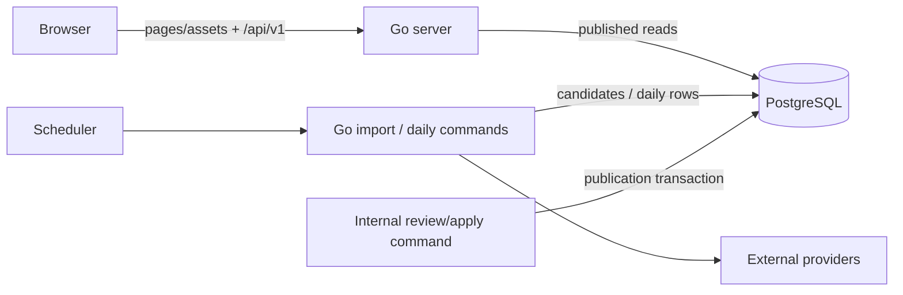

# Unseen V1 — Components and Responsibilities

Design baseline: 2026-10-22. Teaching sequence: [implementation plan](implementation_plan.md).

## 1. Frontend — Existing HTML, CSS, and Browser JavaScript

- Adapt the sibling `unseendesign/unseen/dist/` into this repository's `web/` during implementation.
- Preserve the visual design, responsive styles, keyboard/reduced-motion behavior, and animation hooks.
- Replace mock records and hash navigation with API data and routes from [user_flow.md](user_flow.md).
- Display daily/new discoveries, Earth/Universe listings, search, categories, pagination, details, related discoveries, and separate text/image attribution.
- Render external text safely and support loading, empty, retry, image-failure, and not-found states.
- Use same-origin `/api/v1` requests. Go serves assets and the frontend shell for known page routes; direct refreshes must work.
- The initial static shell can return 200 before the detail API reports a missing discovery as 404. Server-rendered detail status/SEO metadata is deferred.
- No Next.js/React/TypeScript migration is required for this backend-focused version.

## 2. Backend API — Go

- Use `net/http` for routing, JSON handlers, and static delivery.
- Serve only published discoveries from PostgreSQL with parameterized SQL.
- Handle search, filters, pagination, details, related discoveries, categories, and daily discovery.
- Validate requests and translate errors consistently; see [api_design.md](api_design.md).
- Keep provider fetching and internal writes outside public HTTP request handling.
- `/health/live` checks process liveness; `/health/ready` performs a bounded database check and returns 503 on unavailability.
- Use structured logs, request/query timeouts, bounded inputs, and graceful shutdown.

## 3. Database — PostgreSQL

- Store categories, current discovery snapshots, source/image provenance, publication status, import targets, reviewable candidates, and daily selections.
- Source metadata lives on discoveries; no separate sources table is needed in V1.
- Enforce unique source identity, category/domain relationships, publication fields, and one selection per UTC date.
- Stage fetched changes without replacing the approved public snapshot.
- Use `database/sql` with the pgx stdlib driver and versioned SQL migrations through a pinned goose CLI.
- Run migrations explicitly before a release, not automatically from every API replica.

See [database_design.md](database_design.md).

## 4. Internal Commands — Go

One binary/codebase supports serving, importing, reviewing/applying/rejecting candidates, publishing/unpublishing, and daily selection. These are commands, not separate network services.

- Fetch curated Wikipedia page IDs and NASA record IDs; resolve Commons image metadata for approved Earth content.
- Normalize/validate responses, compute canonical hashes, and stage new or changed candidates.
- Keep public snapshots during provider failures and pending/rejected updates.
- Apply a reviewed candidate in one short database transaction, with no external HTTP request inside it.
- Serialize publication per source identity and require matching snapshot versions to reject stale candidates; real source reversions receive fresh review.
- Select daily discoveries independently of fetching.
- Do not expose internal write commands as public HTTP endpoints.

## 5. Scheduler

- Start existing Go commands; do not put an independent scheduling loop in each API replica.
- Daily selection: `00:05 UTC` daily.
- New-candidate import: `01:00 UTC` daily for approved targets not yet published.
- Existing-record refresh: `02:00 UTC` Sundays for published approved targets.
- Prove manual commands before introducing Kubernetes Jobs/CronJobs.
- Set explicit UTC time zone, bounded retries/deadlines, and per-provider run coordination.
- CronJob concurrency settings do not cover manual runs or other jobs; database rules still protect repeat/overlap.

## 6. External Sources

- Wikipedia: curated Earth explanations and available article revisions.
- Wikimedia Commons: Earth images and individual credit/reuse metadata.
- NASA Image Library: curated Universe media records, suitable image variants, descriptions, and supplied credits.
- Use provider search manually to choose targets; scheduled work uses stable approved IDs.
- Source feasibility remains open until the checks in [data-sources.md](data-sources.md) pass.
- Browsing remains PostgreSQL-backed when providers are unavailable.

## 7. Request and Data Flow

## 8. Runtime Progression

1. Native Go plus Docker PostgreSQL, then the whole app in Compose.
2. One local kind cluster. PostgreSQL StatefulSet/PVC is a local learning exercise, not the production database strategy.
3. AWS learning deployment: ECR image, EKS app/Jobs, private RDS PostgreSQL, HTTPS load balancing, managed secrets, CloudWatch logs.

One repository and the same application image throughout. Plain Kubernetes manifests first. Introduce a small Terraform stack only in AWS lessons after explaining the resources. Establish costs before provisioning and practice recovery/cleanup.

## 9. Shared Responsibilities

- Validated configuration, secret handling, and least privilege as introduced.
- Behavior tests using real PostgreSQL and saved/local provider fixtures.
- CI, explicit migrations, compatible releases, deployment checks, and logs without credentials.
- Startup, failed-import, rollback, backup, recovery, and teardown instructions.
- Teach each implementation step and its failure modes; follow the learning gates in the implementation plan.
